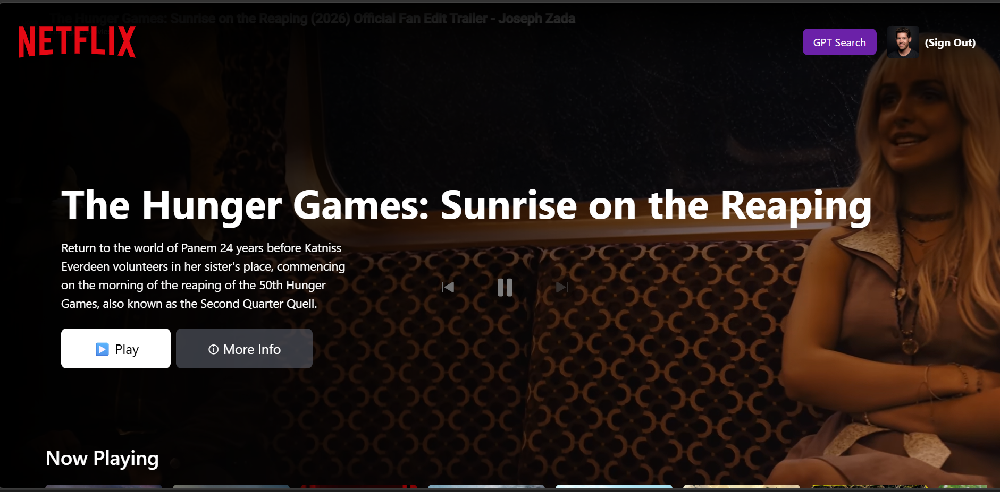
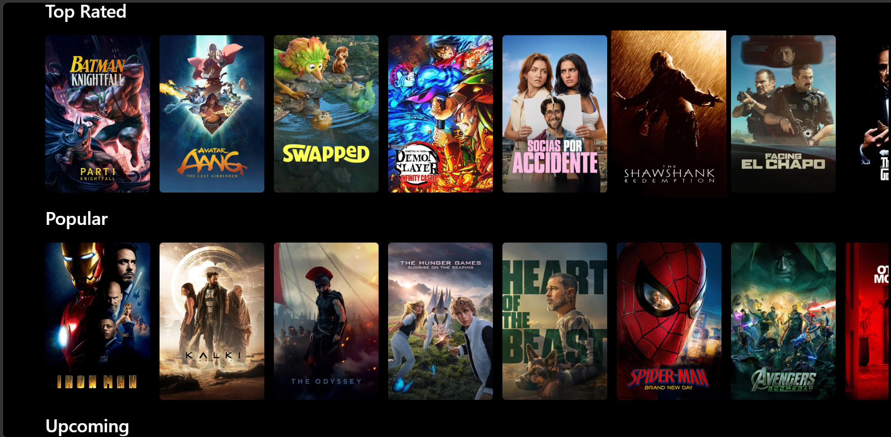
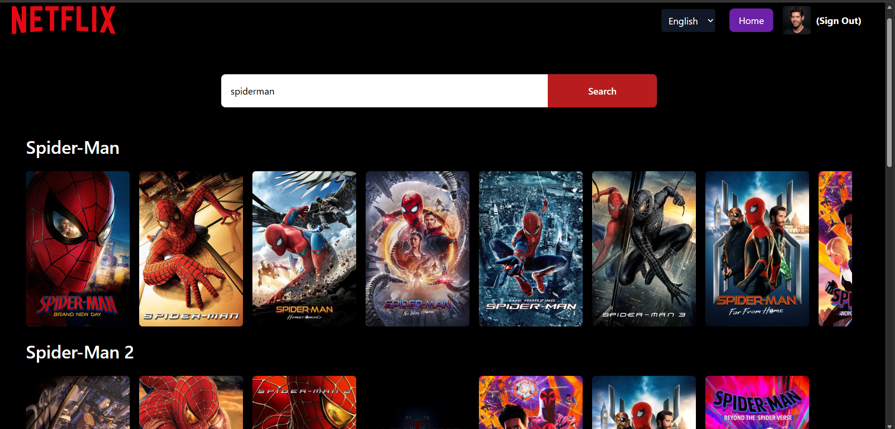
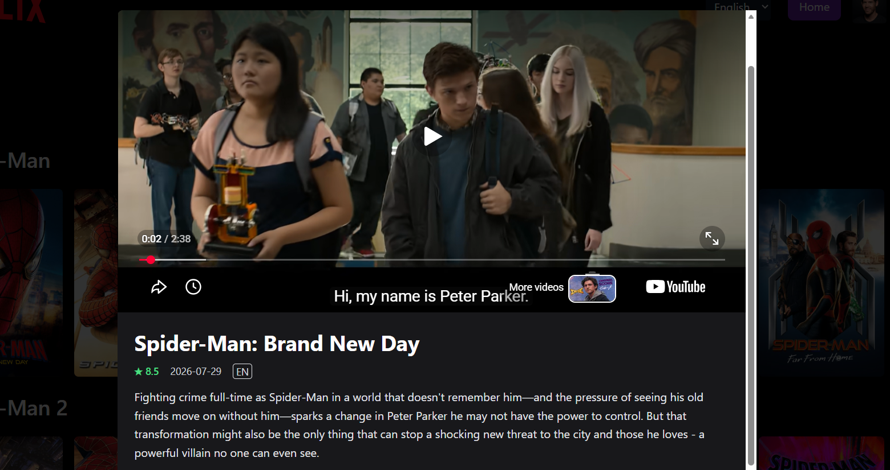

<h1 align="center">NetflixGPT</h1>

<p align="center">
  A Netflix-inspired streaming interface with AI-powered movie discovery.<br/>
  Describe what you want to watch in plain language and get curated results powered by Google Gemini and TMDB.
</p>

<p align="center">
  <a href="https://vercel.com/roshinir/netflix-gpt/HDu3HLQWQVtpBnHubaCkRCeMXyDu"><strong>Live Demo</strong></a>
  &nbsp;|&nbsp;
  <a href="https://github.com/rroshini/netflix-gpt/issues"><strong>Report a Bug</strong></a>
  &nbsp;|&nbsp;
  <a href="https://github.com/rroshinii/netflix-gpt/issues"><strong>Request a Feature</strong></a>
</p>

---

## Table of Contents

1. [Overview](#overview)
2. [Features](#features)
3. [Screenshots](#screenshots)
4. [Tech Stack](#tech-stack)
5. [Architecture](#architecture)
6. [Getting Started](#getting-started)
7. [Environment Variables](#environment-variables)
8. [Available Scripts](#available-scripts)
9. [Project Structure](#project-structure)
10. [How AI Search Works](#how-ai-search-works)
11. [State Management](#state-management)
12. [External APIs](#external-apis)
13. [Performance](#performance)
14. [Deployment](#deployment)
15. [Security Considerations](#security-considerations)
16. [Roadmap](#roadmap)
17. [Contributing](#contributing)
18. [License](#license)
19. [Acknowledgements](#acknowledgements)
20. [Contact](#contact)

---

## Overview

NetflixGPT is a single-page web application that recreates the core browsing experience of a modern streaming platform and extends it with natural-language movie search. Users authenticate, browse categorized catalogs, watch trailers, view movie details, and use an AI search page to discover films by describing a mood, genre, era, or theme instead of typing an exact title.

The project demonstrates production-style front-end patterns: authentication flows, global state management, custom data-fetching hooks, memoized API calls, internationalization, and integration with multiple third-party services.

---

## Features

**Authentication**
- Email and password sign up and sign in through Firebase Authentication
- Client-side form validation for email and password
- Persistent sessions with automatic redirect based on authentication state
- Profile avatar and display name shown in the header after sign in

**Browsing Experience**
- Full-width hero section with an auto-playing, muted trailer behind the featured title
- Featured movie title, synopsis, and Play and More Info actions
- Horizontally scrollable rows for Now Playing, Top Rated, Popular, and Upcoming
- High-resolution posters loaded from the TMDB image CDN

**Movie Details**
- Modal view with an embedded YouTube trailer
- Title, average rating, release date, original language, and full overview

**AI-Powered Search**
- Natural-language queries such as "feel-good comedies from the 2000s"
- Gemini generates a shortlist of relevant titles
- Each suggested title is resolved against TMDB and rendered as its own result row
- Dedicated search page with one-click navigation back to Home

**Internationalization**
- Language selector in the header
- Interface text, placeholders, and button labels update instantly without a page reload

**Quality of Life**
- Responsive layout for desktop, tablet, and mobile
- Memoized fetching to prevent duplicate network requests
- Centralized constants and reusable custom hooks

---

## Screenshots

All taken from the running app on 26 Nov 2026.

<table>
  <tr>
    <td width="50%" valign="top">
      
      <br/>
      Home: featured trailer with title, synopsis, Play and More Info
    </td>
    <td width="50%" valign="top">
      
      <br/>
      Browse: Now Playing, Top Rated, Popular and Upcoming rows
    </td>
  </tr>
  <tr>
    <td width="50%" valign="top">
      
      <br/>
      AI search: describe a movie, get one result row per suggested title
    </td>
    <td width="50%" valign="top">
      
      <br/>
      Details: trailer, rating, release date, language and overview
    </td>
  </tr>
</table>

---

## Tech Stack

**Front end**

| Technology | Purpose |
| --- | --- |
| React | Component-based UI |
| React Router | Client-side routing and route protection |
| Redux Toolkit and React Redux | Global state (user, movies, AI search, language config) |
| Tailwind CSS | Utility-first styling and responsive layout |
| JavaScript (ES6+) | Application language |

**Services and APIs**

| Service | Purpose |
| --- | --- |
| Firebase Authentication | Sign up, sign in, sign out, user profile |
| TMDB API | Movie lists, posters, trailers, details, title search |
| Google Gemini API | Natural-language movie recommendations |
| YouTube Embed | Trailer playback in the hero section and details modal |

**Tooling and deployment**

| Tool | Purpose |
| --- | --- |
| Vite (or Create React App) | Dev server and production bundling |
| npm | Package management |
| Git and GitHub | Version control |
| Firebase Hosting or Vercel | Deployment |

---

## Architecture

```
                 +------------------------+
                 |       React UI         |
                 |  Login | Browse | Search|
                 +-----------+------------+
                             |
              +--------------+--------------+
              |                             |
     +--------v---------+          +--------v---------+
     |  Custom Hooks    |          |  Redux Store     |
     |  (data fetching) +--------->+  user | movies   |
     +--------+---------+          |  gpt  | config   |
              |                    +------------------+
   +----------+-----------+
   |          |           |
+--v---+  +---v----+  +---v------+
| TMDB |  | Gemini |  | Firebase |
| API  |  |  API   |  |   Auth   |
+------+  +--------+  +----------+
```

Data flow in brief: components call custom hooks, hooks fetch from external APIs, results are dispatched to Redux slices, and components subscribe to the slices they need.

---

## Getting Started

### Prerequisites

- Node.js 18 or later
- npm or yarn
- A Firebase project with Email/Password authentication enabled
- A TMDB account and API read access token
- A Google Gemini API key from Google AI Studio

### Installation

```bash
# Clone the repository
git clone https://github.com/your-username/netflix-gpt.git

# Navigate into the project directory
cd netflix-gpt

# Install dependencies
npm install
```

### Configure Firebase

1. Create a project in the [Firebase Console](https://console.firebase.google.com/).
2. Add a Web App and copy the configuration values.
3. Open Authentication, then Sign-in method, and enable Email/Password.

### Configure TMDB

1. Create an account at [themoviedb.org](https://www.themoviedb.org/).
2. Open Settings, then API, and request a developer key.
3. Copy the API Read Access Token.

### Configure Gemini

1. Open [Google AI Studio](https://aistudio.google.com/app/apikey).
2. Create an API key.

### Start the development server

```bash
npm run dev
```

The application is served at `http://localhost:5173` (Vite) or `http://localhost:3000` (Create React App).

---

## Environment Variables

Create a `.env` file in the project root. Never commit this file.

```env
# Firebase
VITE_FIREBASE_API_KEY=
VITE_FIREBASE_AUTH_DOMAIN=
VITE_FIREBASE_PROJECT_ID=
VITE_FIREBASE_STORAGE_BUCKET=
VITE_FIREBASE_MESSAGING_SENDER_ID=
VITE_FIREBASE_APP_ID=

# TMDB
VITE_TMDB_KEY=

# Google Gemini
VITE_GEMINI_KEY=
```

| Variable | Description |
| --- | --- |
| `VITE_FIREBASE_*` | Firebase web app configuration values |
| `VITE_TMDB_KEY` | TMDB API read access token (Bearer) |
| `VITE_GEMINI_KEY` | Google Gemini API key |

If the project uses Create React App, replace the `VITE_` prefix with `REACT_APP_`.

---

## Available Scripts

| Command | Description |
| --- | --- |
| `npm run dev` | Start the development server |
| `npm run build` | Create an optimized production build |
| `npm run preview` | Preview the production build locally |
| `npm run lint` | Run the linter |

---

## Project Structure

```
netflix-gpt/
├── public/
├── screenshots/
│   ├── browse-hero.png
│   ├── movie-rows.png
│   ├── ai-search.png
│   └── movie-details.png
├── src/
│   ├── components/
│   │   ├── Login.js
│   │   ├── Header.js
│   │   ├── Browse.js
│   │   ├── MainContainer.js
│   │   ├── VideoTitle.js
│   │   ├── VideoBackground.js
│   │   ├── SecondaryContainer.js
│   │   ├── MovieList.js
│   │   ├── MovieCard.js
│   │   ├── MovieModal.js
│   │   ├── GptSearch.js
│   │   ├── GptSearchBar.js
│   │   └── GptMovieSuggestions.js
│   ├── hooks/
│   │   ├── useNowPlayingMovies.js
│   │   ├── usePopularMovies.js
│   │   ├── useTopRatedMovies.js
│   │   ├── useUpcomingMovies.js
│   │   └── useMovieTrailer.js
│   ├── utils/
│   │   ├── appStore.js
│   │   ├── userSlice.js
│   │   ├── moviesSlice.js
│   │   ├── gptSlice.js
│   │   ├── configSlice.js
│   │   ├── firebase.js
│   │   ├── gemini.js
│   │   ├── validate.js
│   │   ├── languageConstants.js
│   │   └── constants.js
│   ├── App.js
│   └── index.js
├── .env
├── tailwind.config.js
└── package.json
```

Adjust this tree to match the current repository layout.

---

## How AI Search Works

1. The user submits a free-form query on the search page.
2. The query is embedded in a structured prompt and sent to the Gemini API. The prompt instructs the model to return a short, comma-separated list of movie titles and nothing else.
3. The response is parsed into an array of titles.
4. Each title is searched on TMDB in parallel using `Promise.all`.
5. Results are saved to the `gpt` Redux slice.
6. The search page renders one row per suggested title, using the same movie list and card components as the home page.

Example:

```
Query:    "spiderman"
Gemini:   Spider-Man, Spider-Man 2, Spider-Man: Homecoming, ...
TMDB:     one search request per title
UI:       one result row per title
```

---

## State Management

Redux Toolkit is used with feature-based slices.

| Slice | Responsibility |
| --- | --- |
| `user` | Authenticated user profile (uid, email, display name, photo) |
| `movies` | Now playing, popular, top rated, upcoming, and featured trailer |
| `gpt` | Search view toggle, suggested titles, and resolved TMDB results |
| `config` | Selected interface language |

Authentication state is synchronized using Firebase `onAuthStateChanged`, which dispatches to the `user` slice and handles navigation between Login and Browse.

---

## External APIs

### TMDB

| Endpoint | Usage |
| --- | --- |
| `/movie/now_playing` | Now Playing row and featured movie |
| `/movie/popular` | Popular row |
| `/movie/top_rated` | Top Rated row |
| `/movie/upcoming` | Upcoming row |
| `/movie/{id}/videos` | Trailer lookup for hero and modal |
| `/search/movie` | Resolve AI-suggested titles |

Poster images are served from the TMDB image CDN.

### Google Gemini

A single text-generation request per search, returning a comma-separated list of titles.

### Firebase Authentication

Email and password sign up, sign in, sign out, and profile updates.

---

## Performance

- Memoized data hooks skip network requests when data already exists in the store
- Trailer playback uses the YouTube embed with autoplay, mute, and loop parameters
- Search requests are issued in parallel
- Production builds are minified and code-split by the bundler

---

## Deployment

### Vercel

1. Push the repository to GitHub.
2. Import the project in the Vercel dashboard.
3. Add every variable from the `.env` file under Project Settings, Environment Variables.
4. Deploy.

### Firebase Hosting

```bash
npm install -g firebase-tools
firebase login
firebase init hosting
npm run build
firebase deploy
```

When initializing, set the public directory to `dist` (Vite) or `build` (Create React App) and configure the app as a single-page application.

---

## Security Considerations

Variables prefixed with `VITE_` or `REACT_APP_` are embedded in the client bundle and can be read by anyone who opens the deployed site. For production use:

- Move Gemini requests to a backend or serverless function so the key is never exposed to the browser
- Restrict the Gemini and Firebase keys by HTTP referrer and by API in the Google Cloud Console
- Set usage quotas and billing alerts
- Keep `.env` listed in `.gitignore`
- Apply Firebase Authentication and Security Rules appropriate to your data model

---

## Roadmap

- [ ] Watchlist and favorites
- [ ] Dedicated movie detail page with cast and similar titles
- [ ] Server-side proxy for AI requests
- [ ] Search history and suggested prompts
- [ ] Skeleton loaders and improved error states
- [ ] Unit and integration tests with React Testing Library
- [ ] Multiple user profiles

---

## Contributing

Contributions, issues, and feature requests are welcome.

1. Fork the repository
2. Create a feature branch: `git checkout -b feature/your-feature-name`
3. Commit your changes: `git commit -m "Add your feature"`
4. Push to the branch: `git push origin feature/your-feature-name`
5. Open a pull request

Please keep pull requests focused and include a clear description of the change.

---

## License

Distributed under the MIT License. See the `LICENSE` file for more information.

---

## Acknowledgements

- [The Movie Database (TMDB)](https://www.themoviedb.org/) for movie data and imagery. This product uses the TMDB API but is not endorsed or certified by TMDB.
- [Google Gemini](https://ai.google.dev/) for AI-generated recommendations
- [Firebase](https://firebase.google.com/) for authentication and hosting
- [Tailwind CSS](https://tailwindcss.com/) and [Redux Toolkit](https://redux-toolkit.js.org/)

This is an educational project inspired by Netflix. It is not affiliated with, endorsed by, or sponsored by Netflix, Inc.

---
